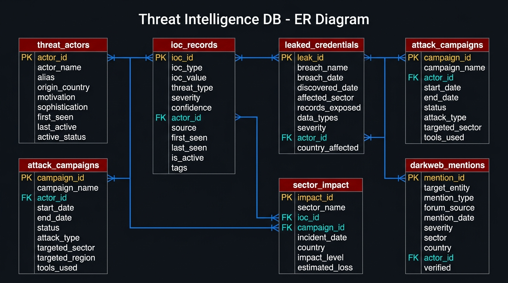

#  Dark Web & Threat Intelligence Tracker


> A **Cybersecurity Analytics Dashboard** built with MySQL and Power BI that tracks Indicators of Compromise (IOCs), APT threat actor profiles, data breaches, attack campaigns, and dark web activity — all using **publicly available threat intelligence data**.

---

## 📌 Project Overview

This project simulates a real-world **Threat Intelligence Platform (TIP)** used by Security Operations Center (SOC) analysts. It aggregates threat data from public sources like MITRE ATT&CK, CISA, and AlienVault OTX into a normalized MySQL database, then visualizes it in a 4-page interactive Power BI dashboard.

### Key Highlights
- **No dark web access required** — all data is from public threat intel feeds
- Tracks **8 known APT groups** (APT28, Lazarus Group, REvil, DarkSide, etc.)
- Monitors **200+ IOCs** across IPs, domains, file hashes, URLs, and CVEs
- Analyzes **10 major data breaches** (AT&T, Ticketmaster, MOVEit, etc.)
- Covers **8 real attack campaigns** (SolarWinds, Colonial Pipeline, etc.)

---

##  Tech Stack

| Layer | Technology |
|-------|-----------|
| Database | MySQL 8.0 |
| Analytics | Microsoft Power BI Desktop |
| Query Language | SQL (CTEs, Window Functions, JOINs) |
| DAX | Power BI DAX Measures |
| Data Sources | MITRE ATT&CK · CISA · AlienVault OTX · NVD |

---

##  Database Schema



### Tables

| Table | Rows (Sample) | Description |
|-------|--------------|-------------|
| `threat_actors` | 8 | APT group profiles (MITRE ATT&CK based) |
| `ioc_records` | 10+ | Malicious IPs, domains, hashes, CVEs |
| `leaked_credentials` | 10 | Major public data breach records |
| `attack_campaigns` | 8 | Known attack operations and their status |
| `sector_impact` | 10 | Industry-wise damage and financial impact |
| `darkweb_mentions` | 10 | Dark web forum activity (from public reports) |

---

##  Dashboard Pages

### Page 1 — 🌍 Threat Landscape Overview
- KPI Cards: Total IOCs, Active Campaigns, Nation-State Actors, Records Breached
- World Map: Threat actor origin countries
- Donut Chart: IOC type distribution
- Bar Chart: Top 5 most active threat actors by IOC count

### Page 2 —  IOC Intelligence Center
- Line Chart: Monthly IOC detection trend
- Alert Table: Active Critical/High severity IOCs
- Heatmap: IOC type vs Severity matrix
- Gauge: Average confidence score

### Page 3 —  Campaigns & Breaches
- Timeline: Campaign activity (Gantt-style)
- Ranked Table: Top 10 breaches by records exposed
- Pie Chart: Campaign status (Active / Completed / Dormant)
- Scatter Plot: Breach size vs Days to discover

### Page 4 —  Dark Web Monitor
- Area Chart: Dark web mentions over time
- Breakdown: Mention type analysis (Credential Sale, Data Sale, etc.)
- Sector Analysis: Most targeted industries on dark web
- Verified Alert Table: Critical confirmed mentions

---

##  How to Run

### Prerequisites
- MySQL 8.0+
- Power BI Desktop (free)
- MySQL ODBC 8.0 Connector

### Step 1 — Set Up Database
```sql
-- Run in order:
source sql/01_schema.sql
source sql/02_sample_data.sql
```

### Step 2 — Connect Power BI
1. Open Power BI Desktop
2. Click **Get Data → MySQL database**
3. Server: `localhost` | Database: `threat_intel_db`
4. Load queries from `sql/03_powerbi_queries.sql`

### Step 3 — Build Dashboard
- See `dashboard/powerbi_setup.md` for DAX measures and theme settings

---

## 📁 Project Structure

```
threat-intel-dashboard/
│
├── sql/
│   ├── 01_schema.sql           # Database design (6 normalized tables)
│   ├── 02_sample_data.sql      # Sample data (based on public threat reports)
│   └── 03_powerbi_queries.sql  # 10 analytical queries for Power BI
│
├── dashboard/
│   └── powerbi_setup.md        # DAX measures + connection guide
│
├── diagrams/
│   └── er_diagram.jpg          # Entity-Relationship diagram
│
├── data/
│   └── sources.md              # Public data sources + API examples
│
└── README.md
```

---

## 📊 SQL Concepts Demonstrated

- ✅ Database normalization (3NF)
- ✅ Multi-table JOINs (LEFT JOIN, INNER JOIN)
- ✅ Window functions (`DENSE_RANK`, `OVER`, `PARTITION BY`)
- ✅ CTEs and subqueries
- ✅ Aggregate functions (`COUNT`, `SUM`, `AVG`, `GROUP_CONCAT`)
- ✅ Date functions (`DATE_FORMAT`, `DATEDIFF`)
- ✅ ENUM types and constraints
- ✅ Indexing for performance
- ✅ Foreign key relationships

---

## 🌐 Public Data Sources Used

| Source | Data Type |
|--------|-----------|
| [MITRE ATT&CK](https://attack.mitre.org) | Threat actor profiles, TTPs |
| [CISA KEV](https://www.cisa.gov/known-exploited-vulnerabilities-catalog) | Exploited CVEs, advisories |
| [AlienVault OTX](https://otx.alienvault.com) | IOC feeds |
| [NVD](https://nvd.nist.gov) | CVE database |
| [PhishTank](https://www.phishtank.com) | Phishing URLs |
| [MalwareBazaar](https://bazaar.abuse.ch) | Malware hashes |

---

## ⚠️ Disclaimer

This project uses **only publicly available data** from legitimate cybersecurity research sources. No actual dark web access, illegal data, or real personal information was used. This is purely an educational project demonstrating data analytics skills in a cybersecurity context.


---

## 📄 License

This project is licensed under the MIT License.
